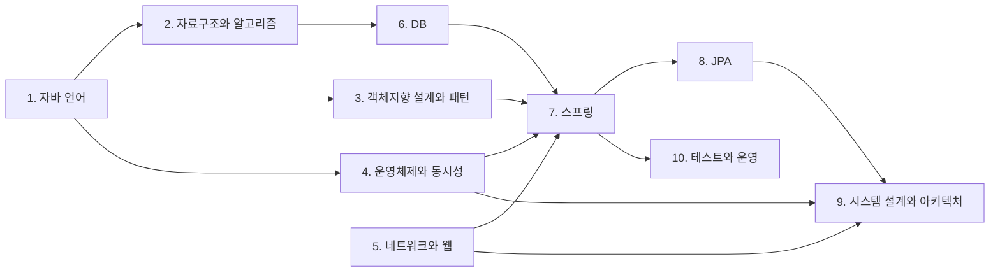

# 로드맵

자바 스프링 개발자로 취업하려는 사람이 면접과 실무에 필요한 개발 지식을 쌓는 과정이다. 대상 독자는 자바 문법을 한 번 배운 사람이다.

- 2026-11-23에 처음부터 다시 짰다. 그 전에 만든 레슨 33개가 있는지는 따지지 않고, 이 대상에게 필요한 것을 기준으로 정했다. 예전 레슨은 맞는 자리에 재료로 쓴다
- 레슨은 핵심 질문 구조(`docs/lesson-standard.md`)로 쓴다. 동작에 대한 주장은 `verification/`의 테스트로 확인한다
- 책의 내용은 옮기지 않는다. 자바 언어 명세와 공식 문서, 직접 돌린 코드를 근거로 쓴다

## 과정

과정은 배우는 순서대로 적었다. 과정 안의 레슨도 배우는 순서다. 화살표는 먼저 배우면 좋은 과정이다.

| 과정 | 핵심 | 심화 | 합계 |
| --- | --- | --- | --- |
| 1. 자바 언어 | 16 | 3 | 19 |
| 2. 자료구조와 알고리즘 | 12 | 2 | 14 |
| 3. 객체지향 설계와 패턴 | 13 | 1 | 14 |
| 4. 운영체제와 동시성 | 9 | 3 | 12 |
| 5. 네트워크와 웹 | 10 | 2 | 12 |
| 6. DB | 12 | 4 | 16 |
| 7. 스프링 | 12 | 4 | 16 |
| 8. JPA | 6 | 5 | 11 |
| 9. 시스템 설계와 아키텍처 | 9 | 12 | 21 |
| 10. 테스트와 운영 | 6 | 4 | 10 |
| 합계 | 105 | 40 | 145 |

- **핵심:** 신입과 주니어 면접에서 기본으로 묻는 것이다. 과정마다 핵심을 먼저 끝낸다
- **심화:** 경력 면접이나 특정 분야(커머스, 핀테크)에서 묻는 것, 실무에서 겪어야 아는 것이다. 다른 학습 서비스에서 잘 다루지 않는 주제라 이 사이트의 강점이 될 수 있다. 핵심을 만든 뒤에 만든다
- 레슨 목록은 후보다. 그 과정을 시작할 때 다시 확인하고, 만들면서 나누거나 합친다

## 만드는 순서

핵심을 먼저, 면접에 자주 나오는 과정부터 만든다.

1. **자바 언어, 자료구조와 알고리즘:** 가장 자주 나오고 뒤 과정의 바탕이다
2. **DB, 스프링, JPA의 핵심:** 재료로 쓸 예전 레슨과 검증 테스트가 많다
3. **객체지향 설계와 패턴, 운영체제와 동시성, 네트워크와 웹의 핵심**
4. **시스템 설계와 아키텍처, 테스트와 운영의 핵심**
5. **심화**

## 표 읽는 법

- **구분:** 핵심 또는 심화
- **재료:** 예전 레슨 가운데 내용과 검증 테스트를 가져다 쓸 수 있는 것. "다시 씀"은 예전 레슨을 핵심 질문 구조로 다시 쓴 레슨이고, "새로 씀"은 재료 없이 처음부터 쓴 레슨이다. 둘 다 이미 있는 레슨이다. 비어 있으면 처음부터 만든다

## 1. 자바 언어

자바 코드가 어떻게 실행되고, 자주 쓰는 타입과 문법이 안에서 어떻게 동작하는지 다룬다. 검증은 DB 없이 자바 코드만 돌리는 테스트로 하고, 실제 출력을 레슨에 보여 준다.

| 번호 | 레슨 | 다루는 것 | 선수 | 구분 | 재료 |
| --- | --- | --- | --- | --- | --- |
| J1 | 자바 프로그램이 실행되는 과정 | 소스, 바이트코드, JVM, JDK와 JRE, 클래스 로딩 | 없음 | 핵심 |  |
| J2 | 값과 참조 | 기본형과 참조형, 메서드에 넘길 때 복사되는 것, ==와 equals | J1 | 핵심 |  |
| J3 | 래퍼 클래스와 오토박싱 | int와 Integer, 자동으로 바뀌는 곳, ==로 비교하면 생기는 일 | J2 | 핵심 |  |
| J19 | 숫자 타입의 한계 | 정수 오버플로, 부동소수점 오차, 돈 계산에 쓰는 BigDecimal. J3 다음에 배운다. 번호는 다른 레슨의 번호를 바꾸지 않으려고 뒤의 것을 썼다 | J3 | 핵심 |  |
| J4 | String | 불변인 이유, 문자열 상수 풀, 문자열을 이어 붙일 때 | J2 | 핵심 |  |
| J5 | static과 초기화 순서 | 클래스에 딸린 것과 객체에 딸린 것, 초기화되는 순서 | J2 | 핵심 |  |
| J6 | equals와 hashCode | 둘을 함께 재정의해야 하는 이유, 규약이 깨지면 생기는 일 | J2 | 핵심 | 새로 씀 (`equals-hashcode`) |
| J7 | 상속과 다형성 | 오버라이딩과 오버로딩, 인터페이스와 추상 클래스 | J2 | 핵심 |  |
| J8 | enum | 상수 묶음, 값마다 다른 동작, 하나뿐인 객체로 쓰기 | J7 | 핵심 |  |
| J9 | 불변 객체 | final, 방어적 복사, record | J2 | 핵심 |  |
| J10 | 예외 | 체크 예외와 언체크 예외, try-with-resources, 예외를 삼키면 생기는 일 | J7 | 핵심 |  |
| J11 | 제네릭 | 타입 안전성, 타입 소거, 와일드카드 | J7 | 핵심 |  |
| J12 | 람다와 함수형 인터페이스 | 람다가 잡는 변수, 메서드 참조 | J7 | 핵심 |  |
| J13 | 스트림과 Optional | 중간 연산과 최종 연산, 지연 평가, null을 다루는 방법 | J12 | 핵심 |  |
| J14 | JVM 메모리 구조 | 스택과 힙, 객체가 놓이는 곳, StackOverflowError와 OutOfMemoryError | J1, J2 | 핵심 |  |
| J15 | 가비지 컬렉션 | 도달할 수 있는 객체, 세대별 수집, 메모리 누수가 생기는 코드 | J14 | 핵심 |  |
| J16 | 중첩 클래스와 익명 클래스 | 바깥 객체를 붙잡는 내부 클래스, 람다와 다른 점 | J7, J12 | 심화 |  |
| J17 | 리플렉션과 어노테이션 | 실행 중에 클래스를 들여다보기. 스프링이 어노테이션을 읽는 방법 | J7 | 심화 |  |
| J18 | 자바 17과 21에서 달라진 것 | record, sealed, switch 패턴 매칭 | J9, J7 | 심화 |  |

## 2. 자료구조와 알고리즘

자바 컬렉션과 코드로 배운다. 면접에서 묻는 "어떻게 동작하고, 얼마나 걸리고, 언제 쓰나"를 다룬다. 코딩 테스트 문제 풀이 연습은 다루지 않는다. 검증은 코드를 돌려 비교 횟수나 걸린 단계 수를 세는 테스트로 한다.

| 번호 | 레슨 | 다루는 것 | 선수 | 구분 | 재료 |
| --- | --- | --- | --- | --- | --- |
| K1 | 시간 복잡도 | 입력이 늘 때 걸리는 시간이 늘어나는 모양, O(1)과 O(n)과 O(log n) | J2 | 핵심 |  |
| K2 | 배열과 연결 리스트 | ArrayList와 LinkedList, 넣고 빼고 찾는 데 걸리는 시간 | K1 | 핵심 |  |
| K3 | 스택과 큐 | 넣고 꺼내는 순서, Deque | K2 | 핵심 |  |
| K4 | 해시 테이블 | HashMap이 동작하는 방식, 충돌, 크기를 늘릴 때 | K1, J6 | 핵심 |  |
| K5 | 재귀 | 자기 자신을 부르는 함수, 호출 스택, 끝나는 조건 | K3 | 핵심 |  |
| K6 | 정렬 | 버블, 퀵, 병합 정렬의 동작과 걸리는 시간, 안정 정렬, Comparable과 Comparator | K5 | 핵심 |  |
| K7 | 이진 탐색 | 정렬된 데이터에서 절반씩 줄이기, 쓸 수 있는 조건 | K6 | 핵심 |  |
| K8 | 이진 탐색 트리 | 정렬된 채로 넣고 찾기, 균형이 깨지면, TreeMap | K7 | 핵심 |  |
| K9 | 힙과 우선순위 큐 | 가장 큰 것을 빨리 꺼내기, PriorityQueue | K8 | 핵심 |  |
| K10 | 컬렉션 고르기 | List, Set, Map의 구현체를 상황에 맞게 고르기 | K2, K4, K8 | 핵심 |  |
| K11 | 그래프와 탐색 | 너비 우선과 깊이 우선의 순서, 각각 맞는 문제 | K3, K5 | 핵심 |  |
| K12 | 그리디와 동적 계획법 | 두 접근의 차이, 같은 계산을 다시 하지 않기 | K5 | 핵심 |  |
| K13 | B-트리 | DB 인덱스가 쓰는 자료구조, 디스크를 덜 읽는 이유 | K8 | 심화 |  |
| K14 | 최단 경로 | 다익스트라가 동작하는 방식 | K11, K9 | 심화 |  |

## 3. 객체지향 설계와 패턴

설계 주제는 의견이 갈린다. 그래서 "어느 쪽이 더 좋은가"를 묻지 않고, 코드를 보여 주고 "요구가 바뀌면 고칠 곳이 어디인가", "이 코드가 어느 원칙을 어겼나"처럼 답이 하나로 정해지는 질문으로 짠다. 검증은 요구를 바꿨을 때 바뀌는 클래스 수와 테스트 결과로 한다.

| 번호 | 레슨 | 다루는 것 | 선수 | 구분 | 재료 |
| --- | --- | --- | --- | --- | --- |
| O1 | 객체지향의 네 가지 특징 | 캡슐화, 상속, 다형성, 추상화가 코드에서 뜻하는 것 | J7 | 핵심 |  |
| O2 | 결합도와 응집도 | 한 곳을 고치면 다른 곳이 깨지는 정도, 관련된 것이 모여 있는 정도 | O1 | 핵심 |  |
| O3 | 단일 책임과 개방 폐쇄 원칙 | SRP, OCP. 요구가 바뀔 때 고칠 곳 | O2 | 핵심 | 새로 씀 (`srp-ocp`) |
| O4 | 리스코프 치환과 인터페이스 분리 원칙 | LSP, ISP. 상속이 깨지는 예 | O3 | 핵심 |  |
| O5 | 의존 역전 원칙과 의존성 주입 | DIP, 구현이 아니라 인터페이스에 기대기 | O3 | 핵심 |  |
| O6 | 상속보다 조합 | 상속으로 재사용할 때 생기는 문제, 조합으로 바꾸기 | O4 | 핵심 |  |
| O7 | 전략 패턴 | 바뀌는 부분을 인터페이스로 빼기 | O5 | 핵심 |  |
| O8 | 템플릿 메서드 패턴 | 뼈대는 부모에, 바뀌는 단계는 자식에. 전략 패턴과 비교 | O6, O7 | 핵심 |  |
| O9 | 팩토리 | 정적 팩토리 메서드, 팩토리 메서드 패턴 | O5 | 핵심 |  |
| O10 | 빌더 패턴 | 인자가 많은 생성자의 문제, 불변 객체와 함께 쓰기 | J9 | 핵심 |  |
| O11 | 싱글톤 패턴 | 만드는 방법, 여러 스레드에서 안전한가, 테스트하기 어려운 이유 | O5, J5 | 핵심 |  |
| O12 | 프록시와 데코레이터 패턴 | 같은 인터페이스로 감싸기. 스프링 AOP로 이어진다 | O7 | 핵심 |  |
| O13 | 옵저버 패턴과 이벤트 | 알리는 쪽과 듣는 쪽을 떼어 놓기 | O5 | 핵심 |  |
| O14 | 어댑터와 퍼사드 패턴 | 맞지 않는 인터페이스 잇기, 복잡한 것을 단순한 창구 뒤에 두기 | O7 | 심화 |  |

## 4. 운영체제와 동시성

| 번호 | 레슨 | 다루는 것 | 선수 | 구분 | 재료 |
| --- | --- | --- | --- | --- | --- |
| C1 | 프로세스와 스레드 | 메모리를 공유한다는 것, 스레드가 따로 가지는 것 | J14 | 핵심 | `process-and-thread` |
| C2 | 컨텍스트 스위칭 | CPU 하나가 여러 스레드를 번갈아 돌리는 방법과 그 비용 | C1 | 핵심 |  |
| C3 | 경쟁 상태와 동기화 | 원자성과 가시성, synchronized, volatile, 원자적 연산 | C1 | 핵심 | `synchronization` |
| C4 | 뮤텍스와 세마포어 | 한 번에 하나만 들어가기와 정해진 수만 들어가기, 자바의 락 | C3 | 핵심 |  |
| C5 | 데드락 | 생기는 네 가지 조건, 락을 잡는 순서 | C4 | 핵심 |  |
| C6 | 스레드에 안전한 객체 | 불변, 스레드에 가두기, ThreadLocal, ConcurrentHashMap | C3, J9 | 핵심 |  |
| C7 | 스레드 풀 | 작업을 받는 규칙, 큐와 거절, 종료 | C1 | 핵심 | `thread-pool` |
| C8 | Future와 CompletableFuture | 결과를 나중에 받기, 잇고 합치기, 예외와 타임아웃 | C7, J12 | 핵심 | `future-and-callable`, `completable-future` |
| C9 | 동기와 비동기, 블로킹과 논블로킹 | 네 가지 조합이 뜻하는 것, 서버가 요청을 기다리는 방식 | C7 | 핵심 |  |
| C10 | 가상 메모리 | 프로세스마다 주소 공간이 따로인 이유, 페이징 | C1 | 심화 |  |
| C11 | 사용자 모드와 커널 모드 | 시스템 콜, 입출력이 비싼 이유 | C2 | 심화 |  |
| C12 | 가상 스레드 | 플랫폼 스레드와 다른 점, 맞는 일과 맞지 않는 일 | C7, C9 | 심화 |  |

## 5. 네트워크와 웹

| 번호 | 레슨 | 다루는 것 | 선수 | 구분 | 재료 |
| --- | --- | --- | --- | --- | --- |
| N1 | 브라우저에 주소를 입력하면 | DNS, TCP 연결, HTTP 요청, 응답까지의 순서 | 없음 | 핵심 |  |
| N2 | OSI 7계층과 TCP/IP 4계층 | 계층을 나누는 이유, 계층마다 하는 일 | N1 | 핵심 |  |
| N3 | TCP와 UDP | 연결을 맺고 끊는 과정, 신뢰성을 지키는 방법 | N2 | 핵심 |  |
| N4 | HTTP 요청과 응답 | 메서드, 헤더, 본문, 상태 코드, 연결 재사용 | N1 | 핵심 |  |
| N5 | REST API 설계 | 자원과 메서드, 안전과 멱등, 상태 코드와 에러 응답 고르기 | N4 | 핵심 | `rest-api` |
| N6 | HTTPS와 TLS | 암호화, 인증서, 연결을 맺는 과정 | N3, N4 | 핵심 |  |
| N7 | 쿠키, 세션, 토큰 | 로그인 상태를 유지하는 세 가지 방법, JWT | N4 | 핵심 | `cookie-session-token` |
| N8 | OAuth 2.0과 소셜 로그인 | 비밀번호를 넘기지 않고 권한을 넘기는 방법, 인가 코드 흐름 | N7, N6 | 핵심 |  |
| N9 | CORS | 브라우저가 막는 요청, 사전 요청, 서버 설정 | N4 | 핵심 |  |
| N10 | 웹 보안 기초 | XSS, CSRF, SQL 인젝션이 일어나는 방식과 막는 방법 | N7, N9 | 핵심 |  |
| N11 | HTTP 캐시 | 캐시 헤더, 조건부 요청, CDN | N4 | 심화 |  |
| N12 | 웹소켓과 SSE | 서버가 먼저 보내야 할 때, 폴링과 비교 | N4 | 심화 |  |

## 6. DB

| 번호 | 레슨 | 다루는 것 | 선수 | 구분 | 재료 |
| --- | --- | --- | --- | --- | --- |
| D1 | 키와 제약 조건 | 기본 키, 외래 키, 유니크, NOT NULL, CHECK | 없음 | 핵심 |  |
| D2 | 조인 | INNER와 OUTER, 조인으로 행이 늘어나는 경우 | D1 | 핵심 |  |
| D3 | 집계와 서브쿼리 | GROUP BY와 HAVING, 서브쿼리와 조인 가운데 고르기 | D2 | 핵심 |  |
| D4 | 정규화 | 중복이 만드는 이상 현상, 제3정규형까지, 일부러 풀 때 | D1 | 핵심 |  |
| D5 | 트랜잭션 기초 | 커밋과 롤백, 자동 커밋, ACID | 없음 | 핵심 | 다시 씀 (`tx-basics`) |
| D6 | DB 커넥션과 커넥션 풀 | 연결의 비용, 빌리고 반납하기, 연결이 모자랄 때 | D5 | 핵심 | 다시 씀 (`connection-pool`) |
| D7 | 인덱스와 실행계획 | 인덱스가 하는 일, 인덱스를 못 타는 경우, 복합 인덱스 | D2, K8 | 핵심 | `index-explain` |
| D8 | 페이지네이션 | offset과 커서, 뒤 페이지가 느려지는 이유 | D7 | 핵심 | `rest-api` |
| D9 | 격리 수준과 이상 현상 | 동시에 도는 트랜잭션이 서로 보는 것 | D5 | 핵심 | `isolation-level` |
| D10 | 낙관적 락과 비관적 락 | 갱신 손실, 두 가지 락의 동작과 고르는 기준 | D9 | 핵심 | `locking` |
| D11 | DB 데드락 | 두 트랜잭션이 서로를 기다릴 때, DB가 푸는 방법, 줄이는 방법 | D10 | 핵심 |  |
| D12 | 관계형 DB와 NoSQL | 무엇이 다르고 언제 무엇을 고르나 | D4, D5 | 핵심 |  |
| D13 | MVCC | 읽기가 쓰기를 기다리지 않는 이유, 스냅샷 | D9 | 심화 |  |
| D14 | 느린 쿼리 고치기 | 실행계획으로 원인 찾기, 고친 뒤 다시 재기 | D7, D3 | 심화 |  |
| D15 | 대량 DML 안전하게 하기 | 한 번에 많이 고칠 때의 위험, 나눠서 하기, 되돌리기 | D5, D10 | 심화 | `bulk-dml` |
| D16 | 스키마 변경과 마이그레이션 | 서비스를 멈추지 않고 테이블 고치기, 마이그레이션 도구 | D5 | 심화 |  |

## 7. 스프링

| 번호 | 레슨 | 다루는 것 | 선수 | 구분 | 재료 |
| --- | --- | --- | --- | --- | --- |
| S1 | 서블릿과 톰캣 | 서블릿 컨테이너가 하는 일, 요청마다 스레드 하나 | N4, C7 | 핵심 |  |
| S2 | 스프링 빈과 의존성 주입 | 컨테이너, 생성자 주입, 싱글톤 | O5 | 핵심 | `spring-beans` |
| S3 | 빈의 생명주기와 스코프 | 만들어지고 사라지는 순서, 싱글톤 빈에 상태를 두면 생기는 일 | S2 | 핵심 |  |
| S4 | 스프링 부트의 자동 설정 | 의존성만 넣으면 동작하는 이유, 설정을 덮어쓰는 방법 | S2 | 핵심 |  |
| S5 | 설정과 프로파일 | 설정 값을 읽는 순서, 환경마다 다른 설정 | S4 | 핵심 |  |
| S6 | 스프링 MVC 요청 흐름 | 요청이 컨트롤러에 닿고 응답이 나가기까지 | S2, S1 | 핵심 |  |
| S7 | 필터와 인터셉터 | 실행되는 위치와 순서, 무엇을 어디에 두나 | S6 | 핵심 |  |
| S8 | 예외 처리와 검증 | @ControllerAdvice, 입력 검증, 에러 응답 형식 | S6, N5 | 핵심 |  |
| S9 | AOP | 프록시로 공통 기능을 끼워 넣는 원리, 어드바이스 순서 | S2, O12 | 핵심 | `aop-audit` |
| S10 | @Transactional 동작 원리 | 프록시가 트랜잭션을 여닫는다, 내부 호출에서 빠지는 이유 | S9, D5 | 핵심 | `transactional-proxy` |
| S11 | 트랜잭션 전파와 롤백 규칙 | 합류와 새 트랜잭션, 롤백되는 예외 | S10 | 핵심 | `tx-propagation` |
| S12 | 인증과 인가 | 스프링 시큐리티의 필터 체인, 세션 방식과 토큰 방식 | S7, N7 | 핵심 |  |
| S13 | 스프링 이벤트 | 이벤트로 떼어 놓기, 커밋 뒤에 실행하기 | S11, O13 | 심화 |  |
| S14 | @Async | 메서드를 다른 스레드에서 돌리기, 기본 설정의 함정 | S9, C7 | 심화 | `thread-pool` |
| S15 | 스프링 배치 | 청크마다 커밋, 실패한 곳부터 다시 | S11 | 심화 | `spring-batch` |
| S16 | 웹플럭스 | 요청마다 스레드를 쓰지 않는 방식, 맞는 일과 맞지 않는 일 | S6, C9 | 심화 |  |

## 8. JPA

| 번호 | 레슨 | 다루는 것 | 선수 | 구분 | 재료 |
| --- | --- | --- | --- | --- | --- |
| P1 | ORM과 JPA | 객체와 테이블의 차이, 엔티티, 리포지토리, JPQL | S2, D5 | 핵심 | `jpa-basics` |
| P2 | 영속성 컨텍스트 | 1차 캐시, 쓰기 지연, 변경 감지 | P1 | 핵심 | `jpa-persistence-context` |
| P3 | 연관관계 매핑 | 외래 키를 관리하는 쪽, mappedBy, 양방향을 쓸 때 | P2, D2 | 핵심 | `association-owner` |
| P4 | 프록시와 지연 로딩 | 가짜 객체가 SELECT를 보내는 때, LazyInitializationException | P2 | 핵심 | `proxy-lazy-loading` |
| P5 | JPA N+1 문제 | 왜 생기나, EAGER가 안 되는 이유, fetch join과 배치 페치, 페이징 | P4 | 핵심 | 다시 씀 (`jpa-n-plus-1`) |
| P6 | OSIV | 영속성 컨텍스트를 요청 끝까지 열어 둘 때 얻는 것과 잃는 것 | P4, S10, D6 | 핵심 | `osiv` |
| P7 | cascade와 orphanRemoval | 부모를 저장하고 지울 때 자식에게 일어나는 일 | P3 | 심화 |  |
| P8 | 벌크 연산과 영속성 컨텍스트 | 한 번에 고치는 쿼리가 1차 캐시와 어긋나는 이유 | P2 | 심화 |  |
| P9 | 식별자 생성 전략 | IDENTITY와 SEQUENCE, 한꺼번에 넣을 때의 차이 | P2 | 심화 |  |
| P10 | 상속 매핑과 값 타입 | 상속을 테이블로 옮기는 세 가지 방법, 임베디드 타입 | P3 | 심화 |  |
| P11 | 동적 쿼리 | 조건이 바뀌는 조회를 만드는 방법, Querydsl | P1 | 심화 |  |

## 9. 시스템 설계와 아키텍처

앞의 과정 위에서 시스템을 설계하는 이야기다. 심화에는 다른 학습 서비스에서 잘 다루지 않는 실무 주제(결제 흐름, 아웃박스, 사가)를 둔다.

| 번호 | 레슨 | 다루는 것 | 선수 | 구분 | 재료 |
| --- | --- | --- | --- | --- | --- |
| A1 | 계층형 아키텍처 | 컨트롤러, 서비스, 리포지토리의 역할과 의존 방향 | S6, O5 | 핵심 |  |
| A2 | 도메인 모델과 트랜잭션 스크립트 | 로직을 어디에 두나, 애그리거트와 경계 | A1, P2 | 핵심 |  |
| A3 | 서버를 늘리는 방법 | 스케일 업과 스케일 아웃, 로드 밸런서, 세션을 어디에 두나 | N7 | 핵심 |  |
| A4 | 캐시 전략과 무효화 | cache-aside, TTL, 무효화 순서, 캐시 스탬피드 | A3 | 핵심 | `cache-strategy` |
| A5 | Redis | 자료구조와 쓰임, 명령이 하나씩 실행된다는 것 | A4 | 핵심 | `redis-ranking` |
| A6 | 멱등성과 중복 요청 방지 | 요청이 두 번 오는 이유, 멱등 키와 유니크 제약 | S10, N5 | 핵심 | `idempotency` |
| A7 | 동시 요청에서 재고 지키기 | 초과 판매, 조건부 UPDATE, DB 락, Redis 차감, 고르는 기준 | D10, A5 | 핵심 | `stock-concurrency` |
| A8 | 메시지 큐 | 큐로 떼어 놓는 이유, 토픽과 컨슈머 그룹, 중복과 유실 | A3 | 핵심 | `kafka-basics` |
| A9 | 모놀리스와 마이크로서비스 | 나눌 때 얻는 것과 잃는 것, 모듈러 모놀리스 | A1, A8 | 핵심 |  |
| A10 | 타임아웃, 재시도, 서킷 브레이커 | 장애가 번지는 것을 막는 세 가지 | A6, C7 | 심화 | `resilience` |
| A11 | 스레드 풀과 커넥션 풀 크기 | 두 풀이 맞물리는 방식, 풀 고갈, 크기 정하기 | D6, C7 | 심화 | `pool-sizing` |
| A12 | 분산 락 | 서버가 여러 대일 때의 락, Redis 락의 한계 | A7 | 심화 |  |
| A13 | 요청 수 제한 | 고정 창, 토큰 버킷, 어디에 두나 | A5 | 심화 |  |
| A14 | 선착순 이벤트 설계 | 몰리는 요청 받기, 중복 참여 막기, 재고 지키기 | A7, A8, A13 | 심화 |  |
| A15 | DB 복제와 샤딩 | 읽기 분리와 복제 지연, 데이터를 나눠 담기 | D9, A3 | 심화 |  |
| A16 | CAP 정리와 결과적 일관성 | 분산 시스템에서 셋을 다 가질 수 없는 이유, 늦게 맞춰지는 데이터 | A15 | 심화 |  |
| A17 | 유일한 ID 만들기 | 자동 증가, UUID, 시간 기반 ID의 차이 | A15 | 심화 |  |
| A18 | 트랜잭셔널 아웃박스 | DB 저장과 메시지 발행이 어긋나는 문제 | S11, A8 | 심화 | `transactional-outbox` |
| A19 | 분산 트랜잭션과 사가 | 2PC를 잘 쓰지 않는 이유, 보상 트랜잭션 | A18 | 심화 | `saga` |
| A20 | 결제 시스템 흐름 | 승인, 매입, 취소, 정산, 대사 | A6, A10, A19 | 심화 | `payment-flow` |
| A21 | 헥사고날 아키텍처 | 포트와 어댑터, 바깥을 바꿔도 안쪽이 그대로인 구조 | A2 | 심화 |  |

## 10. 테스트와 운영

| 번호 | 레슨 | 다루는 것 | 선수 | 구분 | 재료 |
| --- | --- | --- | --- | --- | --- |
| T1 | Git 브랜치와 병합 | 브랜치 전략, merge와 rebase, 충돌 풀기 | 없음 | 핵심 |  |
| T2 | 단위 테스트와 테스트 더블 | 무엇을 테스트하나, 목과 스텁의 차이 | O5 | 핵심 |  |
| T3 | 스프링 테스트 | @SpringBootTest와 슬라이스 테스트, 테스트의 트랜잭션 | S10, T2 | 핵심 |  |
| T4 | 통합 테스트와 Testcontainers | 진짜 DB로 테스트하는 이유와 방법 | T3 | 핵심 |  |
| T5 | 도커와 컨테이너 | 이미지와 컨테이너, 가상 머신과 다른 점 | C1 | 핵심 |  |
| T6 | CI/CD와 무중단 배포 | 자동으로 검사하고 배포하기, 서비스를 멈추지 않고 바꾸기 | T1, T5, T4 | 핵심 |  |
| T7 | 로그와 모니터링 | 로그 수준, 지표, 요청을 따라가는 추적 | S6 | 심화 |  |
| T8 | 리눅스 기초 | 서버에 접속해서 프로세스, 포트, 로그 보기 | C1 | 심화 |  |
| T9 | 부하 테스트 | 얼마나 버티는지 재기, 병목 찾기 | T7 | 심화 |  |
| T10 | 스레드 덤프와 힙 덤프 | 서버가 멈추거나 메모리가 찰 때 원인 찾기 | J15, C5 | 심화 |  |

## 다루지 않는 것

| 주제 | 이유 |
| --- | --- |
| 코딩 테스트 문제 풀이 연습 | 코드를 직접 짜고 채점받아야 느는 영역이다. 이 사이트는 개념을 배우고 며칠 뒤에 다시 꺼내 보는 방식이라 맞지 않는다. 알고리즘은 면접에서 묻는 개념까지만 다룬다 |
| 프런트엔드 (HTML, CSS, 자바스크립트, 리액트) | 대상이 백엔드 개발자다 |
| 특정 클라우드 서비스의 사용법 (AWS 콘솔 등) | 화면과 요금이 자주 바뀌고 테스트로 확인할 수 없다. 배포는 도커와 CI/CD의 원리까지 다룬다 |
| 인성 면접, 자기소개서, 포트폴리오 작성 | 개발 지식이 아니다 |

## 검토했지만 넣지 않은 주제

| 주제 | 이유 |
| --- | --- |
| 자바 직렬화, 자바 I/O와 NIO | 요즘 면접에서 잘 묻지 않는다. 논블로킹 입출력은 "동기와 비동기, 블로킹과 논블로킹"과 웹플럭스 레슨에서 다룬다 |
| 날짜와 시간 API, 정규식 | 쓰는 법을 찾아보면 되는 주제라 꺼내 보는 연습의 가치가 낮다 |
| JPA 2차 캐시 | 실무에서 드물게 쓴다. 캐시는 캐시 전략 레슨에서 다룬다 |
| 검색 엔진 (Elasticsearch) | 제품 하나의 사용법에 가깝다. 필요해지면 심화로 더한다 |
| CQRS와 이벤트 소싱 | 주니어 면접 범위를 넘는다. 필요해지면 심화로 더한다 |
| GraphQL, gRPC | 자바 스프링 신입 채용에서 요구하는 곳이 적다 |

## 예전 레슨 33개의 처리

버리는 레슨은 없다. 모두 새 로드맵의 자리에 재료로 들어간다.

| 처리 | 레슨 | 이유 |
| --- | --- | --- |
| 그대로 둔다 (이미 새 구조) | 트랜잭션 기초, DB 커넥션과 커넥션 풀, JPA N+1 문제 | 새 로드맵에 같은 자리가 있다 |
| 둘을 하나로 합친다 | Future와 Callable, CompletableFuture | 따로 떼면 Future 레슨은 CompletableFuture로 가는 디딤돌일 뿐이다 |
| 둘로 나눈다 | HTTP와 REST API 설계 → REST API 설계, 페이지네이션 | 한 레슨에 주제가 다섯 개라 넓었다. 페이지네이션은 인덱스 뒤에 배워야 읽힌다 |
| 초점을 바꾼다 | AOP와 감사 로그 → AOP | 감사 로그는 예로만 쓴다 |
| 초점을 바꾼다 | Redis 자료구조와 랭킹 → Redis | 랭킹은 예로만 쓴다 |
| 초점을 바꾼다 | 스레드 풀과 ExecutorService → 스레드 풀, @Async | @Async는 스프링 과정으로 옮긴다. 풀 크기는 "스레드 풀과 커넥션 풀 크기"에서 다룬다 |
| 심화로 둔다 | 대량 DML 안전하게 하기, 결제 시스템 흐름 | 신입 면접의 기본은 아니지만, 실무에서 겪어야 아는 내용이고 다른 학습 서비스에 없는 주제다 |
| 심화로 둔다 | 스프링 배치, 타임아웃과 재시도와 서킷 브레이커, 풀 크기, 트랜잭셔널 아웃박스, 사가 | 경력 면접이나 특정 분야에서 묻는 주제다 |
| 재료로 써서 새로 쓴다 | 나머지 | 주제는 맞고, 검증 테스트를 가져다 쓸 수 있다 |

## 아직 정하지 않은 것

- **순서 번호:** 레슨 메타데이터의 `order`와 문제 파일의 `lesson.order`는 아직 예전 번호(1~33)다. 과정 번호와 과정 안의 순서를 합친 번호로 바꿔야 한다 (예: 자바 언어 101~, DB 601~). 학습 앱의 레슨 목록이 과정으로 묶이는 것과 함께 바꾼다
- **단원 이름:** 메타데이터의 `unit`을 과정 이름과 맞춰야 한다
- **이슈:** 레슨의 GitHub 이슈는 그 과정을 시작할 때 만든다
- **레슨 목록의 근거:** 이 목록은 면접에서 자주 나온다고 알려진 주제로 짠 것이고, 채용 공고나 면접 후기를 세어서 정한 것이 아니다

## 만든 기록

- 2026-11-15: JPA, 스프링, DB, 동시성 레슨 19개를 공개했다. 만든 사람의 면접 준비에 맞춘 순서였다
- 2026-11-16: 기초 레슨 4개(트랜잭션 기초, 커넥션 풀, 스프링 빈, JPA 첫걸음)를 더했다 (`docs/reviews/2026-11-16-beginner-review.md`)
- 2026-11-17: 실무 시스템 레슨 10개를 더했다
- 2026-11-21: 레슨 표준을 핵심 질문 구조로 바꿨다 (#90). N+1, 트랜잭션 기초, 커넥션 풀 레슨을 이 구조로 다시 썼다
- 2026-11-23: 대상을 취업을 준비하는 자바 스프링 개발자로 넓히고, 예전 레슨에 얽매이지 않고 과정 10개, 레슨 144개(핵심 104, 심화 40)로 처음부터 다시 짰다. 예전 순서와 이슈 번호는 이 문서의 이전 판(git 기록)에 있다
- 2026-11-23: J6 equals와 hashCode를 썼다 (#117). 자바 실행 유형의 기준 레슨이고, 선수 레슨 J2는 아직 없다. 문제는 `draft`다
- 2026-11-23: O3 단일 책임과 개방 폐쇄 원칙을 썼다. 설계 유형의 기준 레슨이고, 선수 레슨 O2는 아직 없다. 문제는 `draft`다
- 2026-11-25: 자바 언어 과정의 핵심 레슨 14개(J1~J15, J6 제외)의 설계서를 묶어서 승인받았다. 설계서를 쓰며 맡는 레슨이 없는 주제 둘을 찾아, 숫자 타입의 한계(J19)를 더하고 Comparable과 Comparator를 K6에 넣었다. 레슨은 145개(핵심 105, 심화 40)가 됐다
- 2026-11-25: JPA 과정의 핵심 레슨 다섯 개(P1~P4, P6)의 설계서를 썼다. P5는 이미 있다. 예전 레슨의 같은 슬러그를 쓴다
- 2026-11-25: 시스템 설계와 아키텍처 과정의 핵심 레슨 9개(A1~A9)의 설계서를 썼다. A4~A8은 예전 레슨의 같은 슬러그를 쓰고, A5는 랭킹을 예로만 쓰는 Redis 레슨으로 초점을 바꿨다
- 2026-11-25: DB 과정의 핵심 레슨 10개(D1~D4, D7~D12)의 설계서를 썼다. D8 페이지네이션은 새 슬러그 `pagination`이다
- 2026-11-25: 네트워크와 웹 과정의 핵심 레슨 9개(N1~N10, N7 제외)의 설계서를 썼다. 사용자가 설계서 승인을 미리 맡겼다. 예전 `rest-api`는 N5로 다시 쓰고, 페이지네이션은 D8(`pagination`)로 넘겼다
- 2026-11-25: 객체지향 설계와 패턴 과정의 핵심 레슨 12개(O1, O2, O4~O13)의 설계서를 썼다. 사용자가 이번 작업의 설계서 승인을 미리 맡겼다. 레슨 목록의 order는 과정 번호 방식(301~)을 쓴다
- 2026-11-25: 스프링 과정의 핵심 레슨 12개(S1~S12)의 설계서를 썼다. 사용자가 이번 작업의 설계서 승인을 미리 맡겨서 따로 확인받지 않고 본문으로 넘어간다
- 2026-11-25: 자료구조와 알고리즘 과정의 K7~K12 본문을 썼다(이진 탐색, 이진 탐색 트리, 힙과 우선순위 큐, 컬렉션 고르기, 그래프와 탐색, 그리디와 동적 계획법). 문제 60개를 검수해 reviewed로 바꿨다
- 2026-11-25: 자료구조와 알고리즘 과정의 K1~K6 본문을 썼다(시간 복잡도, 배열과 연결 리스트, 스택과 큐, 해시 테이블, 재귀, 정렬). 문제 56개(판정 50, 설명형 6)를 검수해 reviewed로 바꿨다
